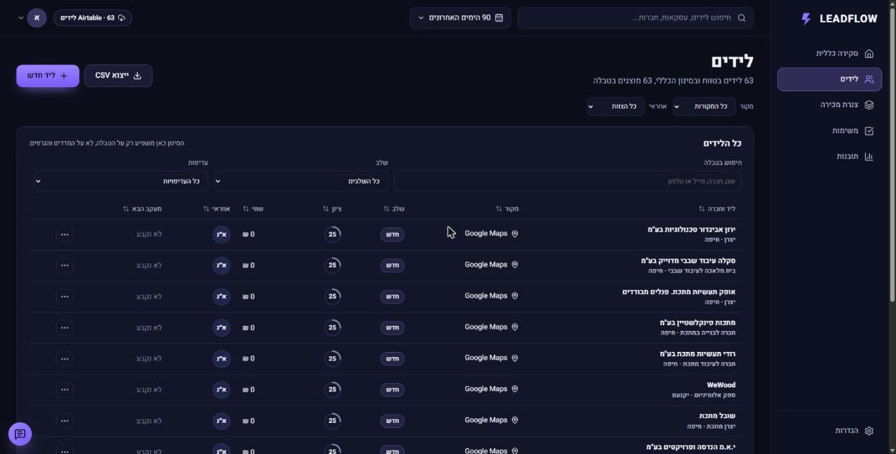

# LEADFLOW: דאשבורד ניהול לידים

**לצפייה:** https://e37dey.github.io/leadflow-dashboard/

דאשבורד בעברית לניהול לידים של עסק קטן: כמה כסף פתוח בצנרת, אילו לידים חמים, מה דורש טיפול היום, ומאיפה מגיעים הלידים. כל הנתונים הם נתוני הדגמה. ברירת המחדל: נוצרים בקוד. מאז שיעור 5 אפשר לטעון אותם מבסיס נתונים ב-Airtable (ראו למטה). אין שרת משלנו, אין CRM אמיתי ואין מודל שפה.

עבודת בית לשיעור 3 בקורס AiDO, אפשרות 4.2. נבנה עם Claude Code לפי השיטה מהשיעור:
- [SPEC.md](SPEC.md): בשביל מי, מה זה ומה זה לא, Must/Should/Later, ומה זה ״גמור״. ה-commit הראשון בריפו, לפני שורת קוד.
- [Practice.md](Practice.md): איך עובדים, כולל שמירה ועדכון ב-GitHub.
- [CLAUDE.md](CLAUDE.md): טוען את שני הקבצים בכל סשן.

## מסכים
- **סקירה כללית:** צנרת פתוחה, סה״כ לידים, לידים חמים, שיעור המרה, גרף ״לידים לאורך זמן״, ״מה דורש טיפול היום?״, התפלגות לפי שלב, מקורות לידים, משימות היום ולידים בעדיפות גבוהה.
- **לידים:** טבלה עם מיון, עמודים, סינון וחיפוש, מגירת ליד לעריכה, ליד חדש וייצוא CSV.
- **צנרת מכירה:** שש עמודות לפי שלב, העברה מתפריט או בגרירה.
- **משימות:** היום, באיחור, בהמשך ובוצעו. יצירה, סימון ופתיחה מחדש.
- **תובנות:** ארבעה כללים עם הראיות שלהם, ״הצג לידים״ ו״צור משימות המשך״.
- **הגדרות:** מקור נתונים (Airtable), ארבעה כיווני עיצוב ואיפוס נתוני ההדגמה.

## מקור נתונים: Airtable, עם לידים אמיתיים (שיעור 5)
בשיעור 3 הדאשבורד עבד רק על נתוני הדגמה מהקוד. עכשיו הוא מושך מ-Airtable **63 לידים אמיתיים**: מפעלי מתכת, מסגריות ובתי מלאכה לעיבוד שבבי בעפולה, מגדל העמק, יקנעם וחיפה, שנאספו מ-Google Maps עם Apify. אלה לקוחות פוטנציאליים לשירותי הנדסה ו-AI.



**הזרימה:**
Google Maps → Apify (`compass/crawler-google-places`, חיפוש: מסגרייה, עיבוד שבבי, ייצור מתכת) → `scripts/maps-to-airtable.mjs` → Airtable (Owners, Leads, Tasks) → LEADFLOW קורא דרך ה-REST API.

- **חיבור:** הגדרות, ״מקור נתונים: Airtable״, מדביקים טוקן קריאה ו-Base ID ולוחצים התחברות. התג בסרגל העליון מתחלף מ״נתוני הדגמה״ ל״Airtable · 63 לידים״.
- **מה נכנס מכל עסק:** שם, קטגוריה ואזור, טלפון, ובהערות: כתובת, אתר, דירוג וקישור ל-Google Maps. כל ליד מתחיל בשלב ״חדש״ עם מקור ״Google Maps״. השווי המשוער לא ידוע, ולכן הוא 0 עד שמעדכנים אותו ב-Airtable. לא ממציאים מספרים, ולכן הצנרת הפתוחה מתחילה ב-₪0.
- **שעון:** נתוני ההדגמה רצים על שעון קבוע (3.11.2026). לידים מ-Airtable רצים על השעה האמיתית, והטווח הוא 90 הימים האחרונים.
- **העלאה בטוחה:** הסקריפט עושה upsert לפי ID (`M-<placeId>`). הרצה ראשונה: 63 נוצרו. הרצה שנייה: 0 נוצרו, 63 עודכנו. בדיקת ספירה: עסקים בקובץ = לידים + דילוגים.
- **הנתונים לא בריפו:** קובץ ה-Apify נשמר ב-`.data/`, שנמצא ב-`.gitignore`. פרטי עסקים לא מתפרסמים בריפו ציבורי.
- **מפתחות:** טוקן קריאה בלבד לדאשבורד (`data.records:read`, ‏`schema.bases:read`, רק הבסיס הזה), שנשמר בדפדפן ורק אם ביקשו. טוקן כתיבה לסקריפטים, שגר בקובץ env מקומי ולא בריפו.
- **קוד:** `src/data/airtableClient.ts` (קריאה, 100 רשומות לבקשה עד שאין `offset`), `src/domain/airtable.ts` (המרה ובדיקה של רשומות), `src/domain/maps.ts` (עסק מ-Google Maps → ליד).
- **בדיקות:** `src/domain/airtable.test.ts`. המרה הלוך ושוב בלי איבוד מידע, רשומה פגומה נדחית, ליד אמיתי לא מקבל שווי מומצא.
- **מה לא:** הדאשבורד לא כותב ל-Airtable. שינויים אחרי הטעינה נשמרים בדפדפן בלבד (SPEC, Later 18). `scripts/upload-airtable.mjs` נשאר להעלאת נתוני ההדגמה לבסיס נפרד, אם צריך.

## הרצה מקומית
```
npm install
npm run dev
```
בדיקות, lint ובנייה:
```
npm test
npm run lint
npm run build
```
**איפוס הנתונים:** הגדרות, ״איפוס נתוני ההדגמה״. השינויים נשמרים ב-localStorage של הדפדפן תחת `leadflow:v1`.

## ציון עדיפות (נוסחה גלויה, לא חיזוי)
| רכיב | נקודות |
|---|---|
| שלב | חדש 10, נוצר קשר 18, מתאים 28, הצעה נשלחה 35 |
| שווי | עד 20, יחסית לשווי, מקסימום מ-₪6,000 |
| קשר אחרון | עד יומיים 20, עד שבוע 14, עד שבועיים 8, אחרת 2. בלי קשר: 15 לליד מהיומיים האחרונים, אחרת 0 |
| מעקב הבא | באיחור 25, היום 22, תוך 3 ימים 12, מאוחר יותר 4, לא נקבע 0 |

ליד חם = ליד פתוח עם ציון 80 ומעלה. ליד סגור מקבל 0. הקוד: `src/domain/score.ts`.

## כללי התובנות
| תובנה | הכלל |
|---|---|
| לידים חמים ממתינים | ליד חם שהקשר האחרון איתו לפני יותר מ-48 שעות, או בלי קשר בכלל |
| מעקבים באיחור | ליד פתוח שתאריך המעקב שלו עבר |
| הצעות מחיר שלא טופלו | שלב ״הצעה נשלחה״ וקשר אחרון לפני יותר מ-7 ימים |
| המקור עם ההמרה הגבוהה | נסגר בהצלחה חלקי לידים, רק מקור עם 5 לידים לפחות |

כל הכללים משתמשים בשעון ההדגמה הקבוע: 3.11.2026, 12:00 שעון ישראל. הקוד: `src/domain/insights.ts`.

## איך זה נבנה
| PR | מה | לפי SPEC |
|---|---|---|
| (commit ראשון) | SPEC, Practice, CLAUDE.md | כל הסעיפים |
| #1 | הקמת הפרויקט, נתוני הדגמה, לוגיקה ו-23 בדיקות | Done means |
| #2 | כל ששת המסכים בעיצוב D | Must 1-8, Should 9-13, כללי תצוגה, נגישות |
| #3 | פרסום ל-GitHub Pages ו-README | Where |
| #4 | עדכון SPEC לפני התיקון: דמות בדויה במקום הכותב, כלל הצבעים מכסה שגיאות ואיפוס | Who, כללי תצוגה |
| #5 | התאמה לכללי התצוגה: טורקיז רק להפניה, לטלפון ולפעולה הבאה, מילה ליד כל מספר, תנועה עד 220ms | כללי תצוגה |

## התאמה ל-SPEC
| דרישה | איפה | בדיקה |
|---|---|---|
| 128 לידים, ספירה לפי שלב, ₪248,000 פתוחים | נתוני ההדגמה | `128 leads...`, `open leads are 91...` |
| מדדים התחלתיים 128 / 32 / 24.2% / ₪248,000 | סקירה כללית | `initial KPIs...` |
| המרה בלי לידים = 0% | סקירה, מצב ריק | `conversion with no leads is 0...` |
| ליד שנסגר מעלה המרה ויוצא מהצנרת | מגירת ליד | `a lead marked won...` ובדיקה בדפדפן |
| ציון לפי הנוסחה, חם = 80 ומעלה | טבלה, מגירה, הגדרות | `follows the documented formula...` |
| סינון גלובלי משנה הכול, והסכומים מתאימים | כל המסכים | `global filters stack...` |
| טווח תאריכים כולל, לפי יום בישראל | בורר התאריכים | `date range is inclusive...` |
| סינון טבלה משפיע רק על הטבלה | לידים | `table filters only narrow the table...` |
| כל תובנה מציגה בדיוק את הלידים שלה | תובנות | `each rule lists exactly the leads...` |
| משימות המשך בלי כפילויות | תובנות | `follow-up tasks are created once...` |
| CSV עם BOM ונטרול נוסחאות | לידים, ייצוא | `CSV: header row...`, `neutralizes spreadsheet formulas...` |
| שמירה פגומה לא שוברת את האתר | אחסון | `broken or old saves are rejected...` |
| שם חובה ולפחות דרך קשר אחת | ליד חדש | בדיקה בדפדפן |
| מקלדת, Esc, החזרת מיקוד | מגירה, חלונות, תפריטים | בדיקה בדפדפן |
| 1440, 1024 ו-390 בלי גלילה לרוחב | כל המסכים | צילומי מסך |
| צבע לפי תפקיד: סגול דיגיטלי ופעולה ראשית, טורקיז הפניה וטלפון ופעולה הבאה, אדום-ורוד איחור, שגיאה ואיפוס | כל המסכים | צילומי מסך, חיפוש בקוד (PR #5) |
| כל מספר עם מילה | תגים בתפריט (״8 לביצוע״), ״ציון״ בצנרת | צילומי מסך |
| **לא** CRM מלא, לא שליחת הודעות, לא מודל שפה | העוזר מסומן ״עוזר הדגמה״ ועונה רק על שאלות קבועות | |

## מה נבדק ומה לא
- נבדק: 23 בדיקות אוטומטיות, בדיקת טיפוסים, lint ובנייה. צילומי מסך ב-1440, 1024 ו-390, בארבעת העיצובים. בדפדפן: טופס ליד חדש עם שגיאות, סימון ליד כנסגר (ההמרה עלתה ל-25.0% והלידים החמים ירדו ל-31), מגירה, עוזר ותובנות.
- מגבלות: הנתונים מקומיים לדפדפן אחד. העוזר לא מבין שפה חופשית, רק את השאלות המוצעות. אין השוואה לתקופה קודמת, כי אין נתונים לתקופה כזו.
