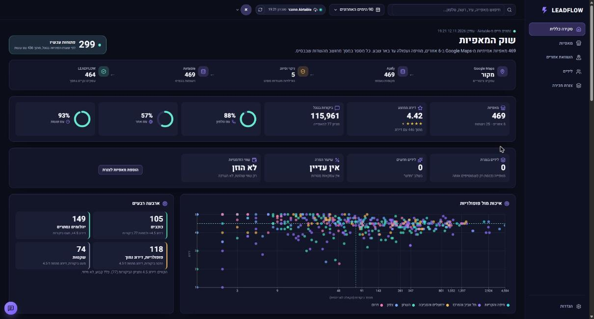
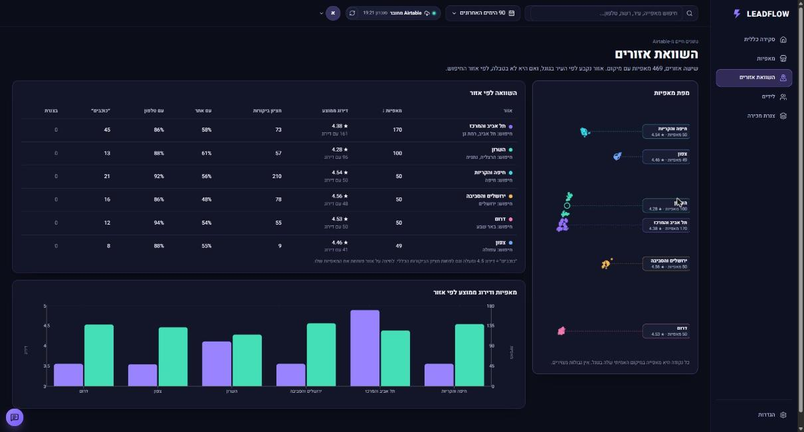

# LEADFLOW: דאשבורד ניהול לידים

**לצפייה:** https://e37dey.github.io/leadflow-dashboard/

דאשבורד בעברית לניהול לידים של עסק קטן: כמה כסף פתוח בצנרת, אילו לידים חמים, מה דורש טיפול היום, ומאיפה מגיעים הלידים. ברירת המחדל: נתוני הדגמה שנוצרים בקוד. מאז שיעור 5 הדאשבורד מושך נתוני אמת מ-Airtable דרך שרת API קטן (ראו למטה). אין CRM אמיתי ואין מודל שפה.

עבודת בית לשיעור 3 בקורס AiDO, אפשרות 4.2. נבנה עם Claude Code לפי השיטה מהשיעור:
- [SPEC.md](SPEC.md): בשביל מי, מה זה ומה זה לא, Must/Should/Later, ומה זה ״גמור״. ה-commit הראשון בריפו, לפני שורת קוד.
- [Practice.md](Practice.md): איך עובדים, כולל שמירה ועדכון ב-GitHub.
- [CLAUDE.md](CLAUDE.md): טוען את שני הקבצים בכל סשן.

## מסכים
- **סקירה כללית:** צנרת פתוחה, סה״כ לידים, לידים חמים, שיעור המרה, גרף ״לידים לאורך זמן״, ״מה דורש טיפול היום?״, התפלגות לפי שלב, מקורות לידים, משימות היום ולידים בעדיפות גבוהה.
- **לידים:** טבלה עם מיון, עמודים, סינון וחיפוש, מגירת ליד לעריכה, ליד חדש וייצוא CSV.
- **צנרת מכירה:** שש עמודות לפי שלב, העברה מתפריט או בגרירה.
- **משימות:** היום, באיחור, בהמשך ובוצעו. יצירה, סימון ופתיחה מחדש.
- **תובנות:** ארבעה כללים עם הראיות שלהם, ״הצג לידים״ ו״צור משימות המשך״.
- **הגדרות:** מקור נתונים (Airtable), ארבעה כיווני עיצוב ואיפוס נתוני ההדגמה.

## מקור נתונים: Airtable, עם נתוני אמת (שיעור 5)
בשיעור 3 הדאשבורד עבד רק על נתוני הדגמה מהקוד. עכשיו הוא מושך **469 מאפיות אמיתיות** מ-Google Maps בשישה אזורים (חיפה והקריות, תל אביב והמרכז, ירושלים, השרון, צפון, דרום) ששמורות ב-Airtable. כל מספר במסך מחושב מהשדות שנטענו. שום ערך לא מומצא, והצנרת מתחילה ריקה: מאפייה הופכת לליד רק כשמוסיפים אותה.




**איך זה עובד (פירוט מלא ב-[docs/REPORT-he.md](docs/REPORT-he.md)):**
Google Maps → Apify → `scripts/places-to-airtable.mjs` → Airtable → **שרת API** (`server/`) → נרמול → מצב הדאשבורד → מדדים, טבלאות וגרפים.

- **הטוקן נשאר בשרת.** השרת רץ בתוך `npm run dev` ו-`npm run preview` וקורא `AIRTABLE_TOKEN` ו-`AIRTABLE_BASE_ID` ממשתני סביבה. הדפדפן מדבר רק עם `/api`.
- **נקודות קצה:** `GET /api/integrations/airtable/status`, `/api/bakeries`, `/api/leads`, `/api/activities`, `/api/dashboard/summary`, `/api/data` (עם `?refresh=1` לקריאה מחדש). כתיבה: `PATCH /api/leads/:id`, `POST /api/activities`.
- **סטטוס בסרגל העליון:** מחובר (רק אחרי קריאה שהצליחה), מסנכרן, שגיאת חיבור, חסרה הגדרה, בסיס ריק. עם שעת הסנכרון האחרון וכפתור רענון.
- **מסכים:** סקירה כללית, מאפיות (חיפוש וסינון לפי אזור, עיר, דירוג, ביקורות, אתר, צנרת, רבע וסיווג), השוואת אזורים (מפה מנקודות אמיתיות, טבלה וגרף), לידים, צנרת מכירה (גרירה נשמרת ב-Airtable).
- **ציון הזדמנות (0 עד 100):** מוניטין, היקף ביקורות, אתר, פרטי קשר ואזור, עם משקלים שמשנים בהגדרות. רכיב בלי נתון לא נספר כאפס. כללים, לא חיזוי.
- **מניעת כפילויות:** עסק יחיד, סניף של רשת, כפילות חשודה (עם הסיבה). כפילות מדויקת לא נכנסת.
- **הנתונים לא בריפו:** עותק מקומי ב-`.data/` (ב-`.gitignore`).
- **הקמת הבסיס:** [docs/AIRTABLE_SETUP.md](docs/AIRTABLE_SETUP.md).

## הרצה מקומית
```
npm install
copy env.example .env.local
npm run dev
```
ממלאים ב-`.env.local` את `AIRTABLE_TOKEN` ו-`AIRTABLE_BASE_ID`. בלי הקובץ הדאשבורד עובד על נתוני ההדגמה, והסטטוס מראה ״חסרה הגדרה״.

בדיקות, lint ובנייה:
```
npm test
npm run lint
npm run build
npm run preview
```
`npm run build` בונה גם את השרת (`dist-server/`), ו-`npm run preview` מריץ אותו.

### תקלות נפוצות
- **״חסרה הגדרה״:** אין `AIRTABLE_TOKEN` או `AIRTABLE_BASE_ID` בשרת. בודקים את `.env.local` ומפעילים מחדש את `npm run dev`.
- **401:** הטוקן לא תקין או שפג. **403:** לטוקן אין גישה לבסיס או אין הרשאת כתיבה. **404:** ‏Base ID או שם טבלה שגויים.
- **429:** יותר מדי בקשות. השרת מנסה שוב לבד; אם זה חוזר, מחכים כמה שניות ולוחצים רענון.
- **כתיבה נחסמה (403 מהדאשבורד):** כתיבה מותרת רק מהדפדפן במחשב שמריץ את השרת.
- **ב-GitHub Pages אין `/api`:** שם אפשר רק להתחבר בהגדרות עם טוקן קריאה, בלי כתיבה.
- **איפוס נתוני ההדגמה:** הגדרות, ״איפוס נתוני ההדגמה״. נשמרים ב-localStorage תחת `leadflow:v1`.

## ציון עדיפות (נוסחה גלויה, לא חיזוי)
| רכיב | נקודות |
|---|---|
| שלב | חדש 10, נוצר קשר 18, מתאים 28, הצעה נשלחה 35 |
| שווי | עד 20, יחסית לשווי, מקסימום מ-₪6,000 |
| קשר אחרון | עד יומיים 20, עד שבוע 14, עד שבועיים 8, אחרת 2. בלי קשר: 15 לליד מהיומיים האחרונים, אחרת 0 |
| מעקב הבא | באיחור 25, היום 22, תוך 3 ימים 12, מאוחר יותר 4, לא נקבע 0 |

ליד חם = ליד פתוח עם ציון 80 ומעלה. ליד סגור מקבל 0. הקוד: `src/domain/score.ts`.

## כללי התובנות
| תובנה | הכלל |
|---|---|
| לידים חמים ממתינים | ליד חם שהקשר האחרון איתו לפני יותר מ-48 שעות, או בלי קשר בכלל |
| מעקבים באיחור | ליד פתוח שתאריך המעקב שלו עבר |
| הצעות מחיר שלא טופלו | שלב ״הצעה נשלחה״ וקשר אחרון לפני יותר מ-7 ימים |
| המקור עם ההמרה הגבוהה | נסגר בהצלחה חלקי לידים, רק מקור עם 5 לידים לפחות |

כל הכללים משתמשים בשעון ההדגמה הקבוע: 3.11.2026, 12:00 שעון ישראל. הקוד: `src/domain/insights.ts`.

## איך זה נבנה
| PR | מה | לפי SPEC |
|---|---|---|
| (commit ראשון) | SPEC, Practice, CLAUDE.md | כל הסעיפים |
| #1 | הקמת הפרויקט, נתוני הדגמה, לוגיקה ו-23 בדיקות | Done means |
| #2 | כל ששת המסכים בעיצוב D | Must 1-8, Should 9-13, כללי תצוגה, נגישות |
| #3 | פרסום ל-GitHub Pages ו-README | Where |
| #4 | עדכון SPEC לפני התיקון: דמות בדויה במקום הכותב, כלל הצבעים מכסה שגיאות ואיפוס | Who, כללי תצוגה |
| #5 | התאמה לכללי התצוגה: טורקיז רק להפניה, לטלפון ולפעולה הבאה, מילה ליד כל מספר, תנועה עד 220ms | כללי תצוגה |

## התאמה ל-SPEC
| דרישה | איפה | בדיקה |
|---|---|---|
| 128 לידים, ספירה לפי שלב, ₪248,000 פתוחים | נתוני ההדגמה | `128 leads...`, `open leads are 91...` |
| מדדים התחלתיים 128 / 32 / 24.2% / ₪248,000 | סקירה כללית | `initial KPIs...` |
| המרה בלי לידים = 0% | סקירה, מצב ריק | `conversion with no leads is 0...` |
| ליד שנסגר מעלה המרה ויוצא מהצנרת | מגירת ליד | `a lead marked won...` ובדיקה בדפדפן |
| ציון לפי הנוסחה, חם = 80 ומעלה | טבלה, מגירה, הגדרות | `follows the documented formula...` |
| סינון גלובלי משנה הכול, והסכומים מתאימים | כל המסכים | `global filters stack...` |
| טווח תאריכים כולל, לפי יום בישראל | בורר התאריכים | `date range is inclusive...` |
| סינון טבלה משפיע רק על הטבלה | לידים | `table filters only narrow the table...` |
| כל תובנה מציגה בדיוק את הלידים שלה | תובנות | `each rule lists exactly the leads...` |
| משימות המשך בלי כפילויות | תובנות | `follow-up tasks are created once...` |
| CSV עם BOM ונטרול נוסחאות | לידים, ייצוא | `CSV: header row...`, `neutralizes spreadsheet formulas...` |
| שמירה פגומה לא שוברת את האתר | אחסון | `broken or old saves are rejected...` |
| שם חובה ולפחות דרך קשר אחת | ליד חדש | בדיקה בדפדפן |
| מקלדת, Esc, החזרת מיקוד | מגירה, חלונות, תפריטים | בדיקה בדפדפן |
| 1440, 1024 ו-390 בלי גלילה לרוחב | כל המסכים | צילומי מסך |
| צבע לפי תפקיד: סגול דיגיטלי ופעולה ראשית, טורקיז הפניה וטלפון ופעולה הבאה, אדום-ורוד איחור, שגיאה ואיפוס | כל המסכים | צילומי מסך, חיפוש בקוד (PR #5) |
| כל מספר עם מילה | תגים בתפריט (״8 לביצוע״), ״ציון״ בצנרת | צילומי מסך |
| **לא** CRM מלא, לא שליחת הודעות, לא מודל שפה | העוזר מסומן ״עוזר הדגמה״ ועונה רק על שאלות קבועות | |

## מה נבדק ומה לא
- נבדק: 23 בדיקות אוטומטיות, בדיקת טיפוסים, lint ובנייה. צילומי מסך ב-1440, 1024 ו-390, בארבעת העיצובים. בדפדפן: טופס ליד חדש עם שגיאות, סימון ליד כנסגר (ההמרה עלתה ל-25.0% והלידים החמים ירדו ל-31), מגירה, עוזר ותובנות.
- מגבלות: הנתונים מקומיים לדפדפן אחד. העוזר לא מבין שפה חופשית, רק את השאלות המוצעות. אין השוואה לתקופה קודמת, כי אין נתונים לתקופה כזו.
