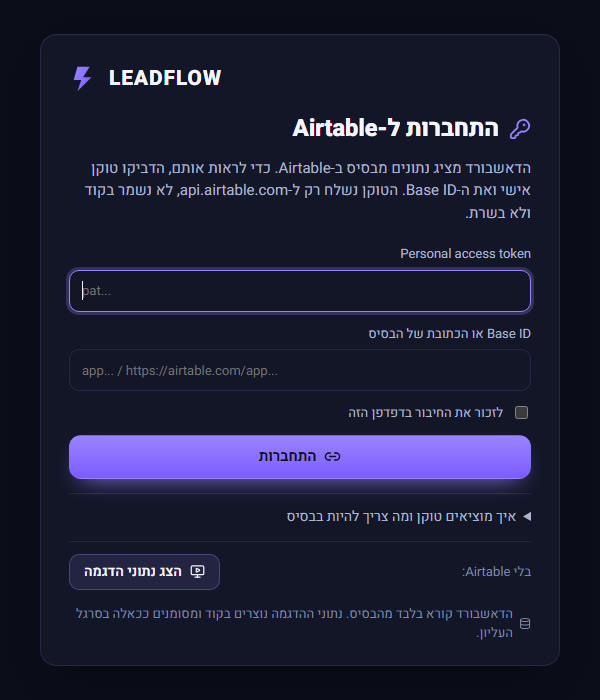

# LEADFLOW: איך הדאשבורד מקבל רשומות מ-Airtable

דוח לשיעור 5, 12.11.2026. עודכן 13.11.2026: מסך התחברות עם טוקן, לפי ההבהרה של המרצה.

## בקצרה
הדאשבורד קורא 469 מאפיות אמיתיות מ-Google Maps ששמורות ב-Airtable, בשישה אזורים. הטוקן נמצא רק בשרת. הדפדפן מבקש JSON מהשרת של הדאשבורד (`/api`), השרת קורא את Airtable, מנרמל, ומחזיר. שינוי שעושים ב-Airtable מופיע אחרי לחיצה על ״רענון״, יחד עם כל המדדים והגרפים שתלויים בו. שינוי שעושים בדאשבורד (הוספה לצנרת, שלב, שווי, הערה) נכתב ל-Airtable.

יש שתי דרכים להעביר טוקן, ושתיהן בריפו:
- **באתר הציבורי (GitHub Pages): מסך התחברות.** הדאשבורד נפתח במסך שמבקש Personal Access Token ו-Base ID, ולא מציג שום נתון לפני טעינה מוצלחת. כל מי שיש לו טוקן ובסיס, כולל בסיס בדיקה עם נתוני דמה, רואה את הדאשבורד על הנתונים שלו.
- **במחשב שלי: secrets.** הטוקן במשתנה סביבה של השרת, והדפדפן לא רואה אותו. כשהשרת מוגדר, אין מסך התחברות.

## זרימת הנתונים
```
Google Maps
  → Apify (compass/crawler-google-places, חיפוש "מאפייה" ב-8 ערים)
  → scripts/places-to-airtable.mjs   (המרה, סיווג כפילויות, אזור, upsert לפי ID)
  → Airtable (Leads, Activities, Owners, Tasks)
  → Server API (server/api.ts, server/airtable.ts)   ← הטוקן כאן בלבד
  → Normalization (src/domain/airtable.ts: fromAirtable)
  → Dashboard State (src/store/store.tsx, דרך src/data/apiClient.ts)
  → KPIs / טבלאות / גרפים (src/domain/summary.ts, opportunity.ts, places.ts)
```

1. **Airtable → שרת.** ‏`server/airtable.ts` קורא כל טבלה בדפים של 100 עד שאין `offset`, שומר מרווח של 220ms בין בקשות (פחות מ-5 בשנייה), וחוזר על 429 ו-5xx עם המתנה הולכת וגדלה. שגיאה אחרת נזרקת עם הסבר בעברית, אף פעם לא ״הצלחה״ ריקה.
2. **מטמון.** התוצאה נשמרת בזיכרון של השרת עם זמן הסנכרון. ‏`?refresh=1` (כפתור הרענון) קורא מחדש מ-Airtable. אחרי כל כתיבה המטמון מתרענן לבד.
3. **נרמול.** ‏`fromAirtable` הופך רשומות לאובייקטים של האפליקציה, מקשר לפי השדה `ID`, ודוחה רשומה פגומה עם סיבה (למשל פעילות שלא מקושרת לליד קיים). שדה לא ידוע נשאר `null` ומוצג ״לא ידוע״. בלי ביקורות אין דירוג, לא 0.
4. **נקודות קצה (JSON):** ‏`/api/integrations/airtable/status`, ‏`/api/bakeries`, ‏`/api/leads`, ‏`/api/activities`, ‏`/api/dashboard/summary`, ‏`/api/data`. כתיבה: ‏`PATCH /api/leads/:id`, ‏`POST /api/activities`, עם בדיקת קלט, רק מהמחשב הזה, מאותו origin ועם כותרת של האפליקציה.
5. **סטטוס.** ״מחובר״ מוצג רק אחרי קריאה אמיתית שהצליחה. אחרת: חסרה הגדרה, שגיאת חיבור (עם הסיבה), בסיס ריק, או מסנכרן. בסרגל העליון רואים את המצב, את שעת הסנכרון האחרון וכפתור רענון.
6. **מסכים.** סקירה כללית, מאפיות, השוואת אזורים, לידים, צנרת מכירה. כל מספר הוא ספירה, סכום, חציון או ממוצע של שדות שנטענו.

## מסך התחברות עם טוקן (13.11)



- **מתי מופיע:** בעלייה הדאשבורד בודק אם יש שרת עם טוקן. אם אין (GitHub Pages) ואין חיבור שמור שעבד, מוצג המסך הזה במקום הדאשבורד. עד שהבדיקה מסתיימת מוצג רק ״טוען...״, כך שגם נתוני ההדגמה לא מהבהבים לפני המסך.
- **שדות:** טוקן (מוסתר), ‏Base ID (אפשר להדביק את כל הכתובת של הבסיס, והמזהה נשלף ממנה), ו״לזכור את החיבור בדפדפן הזה״, כבוי כברירת מחדל. הטוקן נשלח רק ל-api.airtable.com (`src/data/airtableClient.ts`).
- **שגיאות בעברית לפי הסטטוס:** פורמט שגוי (לא מתחיל ב-pat), ‏401, ‏403 (כולל טבלה שלא קיימת), ‏404, ‏429, אין רשת. המסך לא נסגר עד טעינה מוצלחת.
- **בסיס בדיקה:** רק טבלה בשם `Leads` חובה. ‏`Owners` ו-`Tasks` נטענות ריקות אם הן חסרות, ומופיעה הודעה. מספרים ותיבות סימון שיובאו מ-CSV כטקסט נקראים נכון. ‏Created at ריק נלקח מתאריך יצירת הרשומה ב-Airtable.
- **תבנית:** [`public/airtable-template/Leads.csv`](../public/airtable-template/Leads.csv), ‏12 מאפיות בדויות בשישה אזורים, להורדה גם ממסך ההתחברות. ההוראות: [docs/AIRTABLE_TEST_BASE.md](AIRTABLE_TEST_BASE.md).
- **״הצג נתוני הדגמה״:** כפתור משני למי שאין לו Airtable. הנתונים מסומנים ״נתוני הדגמה״ בסרגל העליון.
- **חיבור אמיתי באתר הציבורי (13.11):** התחברתי ב-https://e37dey.github.io/leadflow-dashboard/ עם Personal Access Token אישי ו-Base ID של LEADFLOW, והדאשבורד נטען מ-Airtable. אותו קוד טעינה, מול אותו בסיס, משך 469 רשומות בלי דחיות. ‏Base ID של בסיס אחר (המכירות של המאפייה) מקבל הודעה שאין בו טבלה בשם Leads, עם רשימת הטבלאות שיש בו.
- **נבדק בדפדפן:** בשרת בלי טוקן ובעותק סטטי כמו GitHub Pages, המסך מופיע ראשון. טוקן בפורמט שגוי מקבל הודעה. טוקן בדוי נשלח ל-Airtable וחזר 401, וההודעה ״הטוקן לא תקין או שפג תוקפו (401)״ הוצגה. ה-Base ID נשלף נכון מכתובת שהודבקה. ״הצג נתוני הדגמה״ נכנס ונשאר אחרי רענון. בטלפון ברוחב 375 אין גלילה אופקית. עם השרת והטוקן המקומיים הנתונים נטענים ישר, בלי המסך. אחרי ה-merge האתר הציבורי נפתח במסך הזה.

## מה נבדק בפועל
- **חיבור אמיתי:** ‏`status` החזיר `connected`, עם 469 רשומות ב-Leads, 1 ב-Owners, 0 ב-Tasks וב-Activities, ו-0 רשומות שנדחו.
- **שינוי ב-Airtable מופיע בדאשבורד:** שיניתי ב-Airtable את הדירוג של ״מאפית גילת״ (באר שבע) מ-4.4 ל-2.0. ה-API החזיר 2, הממוצע של דרום ירד מ-4.53 ל-4.48 והממוצע הכללי מ-4.420 ל-4.414, והמסך הציג ★ 2.0. החזרתי ל-4.4 ב-Airtable, לחצתי ״רענון״ במסך: חזר 4.4, וציון ההזדמנות התלוי בו עלה מ-65 ל-86.
- **כתיבה מהדאשבורד ל-Airtable:** הוספה לצנרת, שינוי שלב ל״מתאים״, שווי ₪3,500 והערה. ב-Airtable נמצאו Pipeline מסומן, Stage = qualified, ‏Estimated value = 3500 ו-3 רשומות ב-Activities. הצנרת והמדדים בסקירה (1 ליד, ₪3,500, ״שיעור המרה: אין עדיין״) התעדכנו. אחרי הבדיקה החזרתי את הרשומה למצב הקודם ומחקתי את 3 רשומות הבדיקה, כך שהצנרת שוב ריקה.
- **10 לידים לפי כלל גלוי:** אחר כך הוספתי לצנרת את 10 המאפיות עם ציון ההזדמנות הגבוה ביותר (לא כולל כפילויות חשודות ועסקים סגורים), דרך ה-API של הדאשבורד. כולן בשלב ״חדש״, בלי שווי ובלי שלב מתקדם, כי אלה היו נתונים מומצאים. ב-Activities נרשמו 10 פעולות ״נוסף לצנרת״.
- **בדיקות אוטומטיות:** 70 עוברות (`npm test`). מסך ההתחברות (`src/data/airtableClient.test.ts`): בסיס עם Leads בלבד מתוך התבנית, ערכים כטקסט, Created at ריק, שגיאה בטבלת Leads עוצרת את הטעינה בלי הצלחה מזויפת, הטוקן נשלח רק ל-api.airtable.com, שליפת Base ID מכתובת. השרת מול Airtable מדומה: חסרה הגדרה לא מחזירה ״מחובר״, 401 מחזיר שגיאה עם הסיבה, קריאה של שני דפים, מטמון עד רענון, שינוי ב-Airtable מופיע אחרי רענון, כתיבה, חסימת כתיבה בלי הכותרת, ממחשב אחר או מ-origin אחר, ומצב קריאה בלבד שחוסם כל כתיבה.
- **איכות:** ‏`tsc -b`, ‏`oxlint` ו-`npm run build` (כולל בניית השרת) עוברים.
- **טלפון:** ברוחב 375 אין גלילה אופקית במסכים סקירה, השוואת אזורים וצנרת. במאפיות היה פיקסל עודף ותוקן.
- **הטוקן לא בתשובות:** בדיקה אוטומטית מוודאת שהטוקן וה-Base ID המלא לא מופיעים ב-JSON.

## מה לא נבדק או לא נבנה
- **פריסה לאינטרנט עם השרת:** לא בשימוש. GitHub Pages סטטי, ושם הדאשבורד עובד עם מסך ההתחברות (טוקן קריאה בדפדפן, בלי כתיבה). בריפו יש הגדרה מוכנה ל-Netlify (`netlify.toml`, ‏`netlify/functions/api.mts`): אותו שרת כ-Function, במצב קריאה בלבד. כדי להפעיל אותה צריך אתר ב-Netlify עם טוקן קריאה ו-Base ID בהגדרות שלו. היא נבדקה מקומית מול Airtable (469 רשומות, כתיבה נחסמת), אבל לא נשארה באוויר.
- **מחסנית אחרת מהבקשה:** לא עברנו ל-Next.js, ‏shadcn/ui, ‏TanStack ו-Zod. הוחלט להרחיב את LEADFLOW הקיים (Vite + React) עם שכבת שרת. הבדיקה של הקלט בשרת כתובה ידנית (`server/validate.ts`).
- **Playwright:** לא נכתבו בדיקות E2E. הבדיקות בדפדפן נעשו ידנית, בעזרת Claude.
- **מסכים שלא נבנו:** ״מקורות לידים״ (כל המקור הוא Google Maps, אין עוד מקורות אמיתיים) ו״דוחות״ (יש ייצוא CSV). גרף ״מגמת יצירת לידים״ לא נבנה: כל 10 הלידים נוספו באותו יום, אז אין עדיין מגמה.
- **ציון הזדמנות:** תוקן באג. מאפייה בלי ביקורות בכלל קיבלה 100 רק על אתר וטלפון. עכשיו, אם הנתונים מכסים פחות מחצי מהמשקל, אין ציון.
- **מפה:** נקודות על הקואורדינטות האמיתיות, בלי גבולות אזורים (אין לנו גבולות אמיתיים).
- **אזור:** נקבע לפי עיר מטבלה קבועה, ואם העיר לא בטבלה, לפי אזור החיפוש. הרצליה נספרה בשרון.

## הדגמה למרצה, צעד אחר צעד

**עם טוקן משלך, בלי להריץ כלום:**
1. בסיס חדש ב-Airtable, טבלה בשם `Leads`, וייבוא של [Leads.csv](../public/airtable-template/Leads.csv) (או בסיס קיים עם טבלה כזאת).
2. ‏Builder hub, ‏Personal access tokens: טוקן עם `data.records:read` ו-`schema.bases:read`, וגישה לבסיס הזה.
3. פותחים https://e37dey.github.io/leadflow-dashboard/, מדביקים טוקן ו-Base ID ולוחצים ״התחברות״.
4. הדאשבורד נטען על הנתונים מהבסיס. משנים דירוג ב-Airtable, לוחצים על כפתור הרענון ליד הסטטוס, והערך החדש מופיע.

**עם השרת (secrets), במחשב שלי:**
1. ‏`npm install`. יוצרים `.env.local` לפי `env.example` עם `AIRTABLE_TOKEN` ו-`AIRTABLE_BASE_ID`.
2. ‏`npm run dev` ופותחים http://127.0.0.1:5180/leadflow-dashboard/
3. בסרגל העליון: ״Airtable מחובר״ עם שעת סנכרון. בהגדרות: ספירות לכל טבלה.
4. במסך ״מאפיות״ מחפשים מאפייה ורושמים את הדירוג.
5. פותחים את הבסיס ב-Airtable, טבלה Leads, ומשנים לה Rating.
6. חוזרים לדאשבורד ולוחצים על כפתור הרענון ליד הסטטוס.
7. הדירוג החדש מופיע, וגם הממוצע של האזור (השוואת אזורים) וציון ההזדמנות משתנים.
8. בכיוון השני: פותחים מאפייה, ״הוספה לצנרת״, משנים שלב ושווי, ורואים את השינוי ב-Airtable.

## קישורים
- ריפו: https://github.com/E37dey/leadflow-dashboard (ענף `main`)
- האתר: https://e37dey.github.io/leadflow-dashboard/
- הגדרת הבסיס: [docs/AIRTABLE_SETUP.md](AIRTABLE_SETUP.md)
- בסיס בדיקה עם נתוני דמה: [docs/AIRTABLE_TEST_BASE.md](AIRTABLE_TEST_BASE.md)
